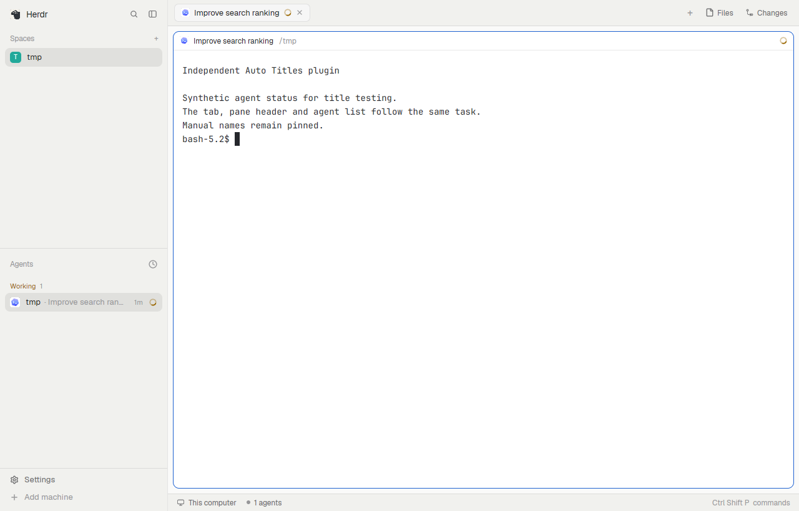

# Herdr Auto Titles

Automatic task titles for the **Herdr desktop app**, distributed as a **community mod**. The installer, CLI, JSON API and MCP server run in Rust. The small UI mods remain JavaScript because that is Herdr’s extension interface. No Node runtime, custom Herdr build or source checkout is required.

- Task titles across tabs, pane headers, agent rows, sub-agent previews and the tab picker.
- Spinner noise removed; program/folder labels when an agent does not report a task title.
- Manual names stay pinned. **Use automatic title** restores live naming.
- Three layouts: `auto-titles-main`, `auto-titles-terminals`, `auto-titles-win98`.
- Matching CLI, JSON API, MCP tools and generated agent documentation.

This is a desktop mod, **not a plugin for the old Herdr TUI**. It does not generate AI summaries or read transcripts.



## Add the mod to your layout

The [community mod package](community/auto-titles/RECIPE.md) contains the recipe,
preview, `mods/auto-titles-*` folders and agent reference, with **no layouts**.
Give that folder to your agent to add the title modules to a personal copy of your
current layout. It preserves your arrangement and manual names. The repository
uses the `herdr-mod` topic for discovery at [Herdr Mods](https://herdr.dev/mods/).

> Add the Auto Titles mod from https://github.com/mustafaTokmak/herdr-auto-titles/tree/main/community/auto-titles to my current Herdr layout. Read its recipe and files first, preserve my custom controls and manual names, validate the mods, and keep my sessions running. Verify the rendered titles using the documented CLI/API/MCP interface.

## Optional native installer

The existing installer remains available for a ready-configured setup. It installs
the same mods plus three supporting layouts; it does not use the manual gallery
installation's ownership. Choose one installation method.


Requires Herdr desktop **0.1.9+**. Open Herdr once first, then download and extract the native archive for your platform from [Releases](https://github.com/mustafaTokmak/herdr-auto-titles/releases/latest): Linux x86-64, macOS Apple Silicon, or Windows x86-64.

```sh
./herdr-auto-titles install
```

On Windows use `.\herdr-auto-titles.exe install`. Keep the executable for later commands. It embeds the entire mod payload and works outside this repository; Node is not required. Unsigned binaries may require your operating system's normal trust approval.

The installer checks all 11 mods, installs files under `mods/auto-titles-*` and `layouts/auto-titles-*`, and selects `auto-titles-main`. Your terminals and sessions stay running. It never overwrites built-in mods, layouts, or settings. Standard picker shortcuts are redirected only inside the plugin layouts; custom shortcuts are preserved.

Set `HERDR_APP_BIN` to the Herdr executable if it is not on PATH. `HERDR_APP_HOME` selects a different app home. These variables apply to all commands and agent tools.

```sh
./herdr-auto-titles install --no-activate
./herdr-auto-titles enable main       # or terminals / win98
./herdr-auto-titles status
```

From source, build with Rust:

```sh
cargo build --release --locked
./target/release/herdr-auto-titles install
```

## Update or remove

Download the newer executable and run `install` again. Existing v1 Node installations and receipts are supported.

```sh
./herdr-auto-titles install       # update; validates ownership before writing
./herdr-auto-titles disable       # return to the previous layout
./herdr-auto-titles uninstall     # remove owned files and scoped shortcuts
```

Updates and removal refuse locally edited plugin files. Save edits in a separate clone first. Files you add inside a plugin folder are retained. A receipt and operation lock live under `data/herdr-auto-titles/`; the small lock file remains after removal. The native installer serializes writes and checks ownership again after mod validation. Win98's normal pixel-grid scaling is recognized; other layout edits are protected.

If Herdr is closed, installation succeeds and reports that activation is pending; open Herdr and run `enable`. Offline removal leaves Herdr to fall back to its stock layout on the next start.

## Names and existing tabs

The plugin follows useful titles reported by programs. Agents without a task title get a program/folder fallback. Focusing another split does not change which pane supplies the tab title.

A manual name always wins—even `Codex`, `1`, or an old program name assigned by Herdr's launcher. Right-click that tab and choose **Use automatic title** to opt it in. New tabs created through the plugin's agent menus start with automatic names.

Custom layouts are not rewritten. The bundle uses its own copies of Herdr 0.1.9's UI mods, so it receives UI updates when this project updates. Sub-agent previews opened from its agent list use the new titles; terminal-address links handled by the host still use the stock preview. Global shortcuts and other stock layouts retain their normal behavior.

## For agents

All plugin workflows have equivalent JSON API endpoints and MCP tools, including install, update, activation and uninstall. The source of truth is [agent-tools.json](agent-tools.json); [llms.txt](llms.txt), [llms-full.txt](llms-full.txt) and [SKILL.md](SKILL.md) are generated from it.

```sh
./herdr-auto-titles             # MCP stdio server
./herdr-auto-titles --http 0          # loopback API; prints the URL
./herdr-auto-titles list              # rendered titles and automatic/manual modes
./herdr-auto-titles rename TAB_ID "Fix login"  # pin a name
./herdr-auto-titles rename TAB_ID ""           # automatic again
```

Configure an MCP client with `command: "/absolute/path/to/herdr-auto-titles"` (or the `.exe` on Windows) and no arguments. All transports use the same Rust handlers. Keep stdout dedicated to MCP when running without arguments. The HTTP interface is for local agent clients and rejects browser origins and non-loopback hosts.

Copy-paste prompt:

> Install the independent Herdr Auto Titles mod from github.com/mustafaTokmak/herdr-auto-titles. Preserve my names and custom files, and do not restart any app or terminal. Verify the active layout with herdr_auto_titles_status and inspect titles with herdr_titles_list. Only rename or reset the tabs I identify.

## Development

```sh
cargo test --locked
npm test                       # JavaScript UI and optional legacy adapter tests
npm run docs
npm run docs:check
npm run gallery                # refresh the mods-only gallery package
npm run gallery:check          # reject missing or stale gallery files
```

Tests cover titles, native MCP/HTTP processes, execution outside the checkout without Node, v1 receipt upgrades, lifecycle ownership, local-edit protection, scoped shortcuts, symlink escapes, cleanup, generated documentation and API/MCP coverage. Node 22+ is used only for developer tests/docs generation and the optional v1 compatibility scripts (`agent.mjs`, `install.mjs`). The mod files are self-contained so they can be cloned independently.

## License and upstream

Apache-2.0. Based on Herdr 0.1.9's mods and layouts with the changes described in [NOTICE](NOTICE). Bundled fonts and icons retain their upstream notices. This is an independent project, not an official Herdr release.
